# 大力丸（JavaFX）

大力丸是本地运行的桌面工具箱，覆盖日常开发中最常临时查一下的几件事：JSON 处理、MyBatis 日志还原 SQL、摘要计算、UUID 与随机字符串生成、时间戳、编码转换、对称/非对称加密、文本比对、二维码、图片元数据、OCR，以及 Office 与 PDF 的相互转换。不联网、不上传任何内容、不依赖第三方服务。

界面配色默认跟随系统（Windows 深色/浅色模式），也可在标题栏一键切成固定深色或浅色；左侧图标导航按功能分组，右侧固定的标题栏显示当前功能与说明。窗口初始尺寸按屏幕可用区域的比例计算，1366×768 的笔记本和 2K/4K 显示器上都不会显得过挤或空旷。

深色主题：


浅色主题：


---

## 功能

完整的逐项清单（含全局能力、技术选型、已知限制与后续建议）见 [docs/FEATURES.md](docs/FEATURES.md)。

左侧导航共 18 个页面，按常用性从高到低排列：JSON、SQL（MyBatis 日志还原）、转换（时间戳/Base64/URL/Unicode）、生成（UUID · 随机串）、工具（二维码/比对/图片信息/OCR）、摘要、加密、文档七组；同组内也按使用频率排序，哈希摘要这类「偶尔核一下」的往后放。可在「界面设置」里按需隐藏——**隐藏不等于删掉**，被收起来的页面会进侧栏底部的「更多（N）」，点开就在导航末尾展开「已隐藏」一组，照常可以选中使用。

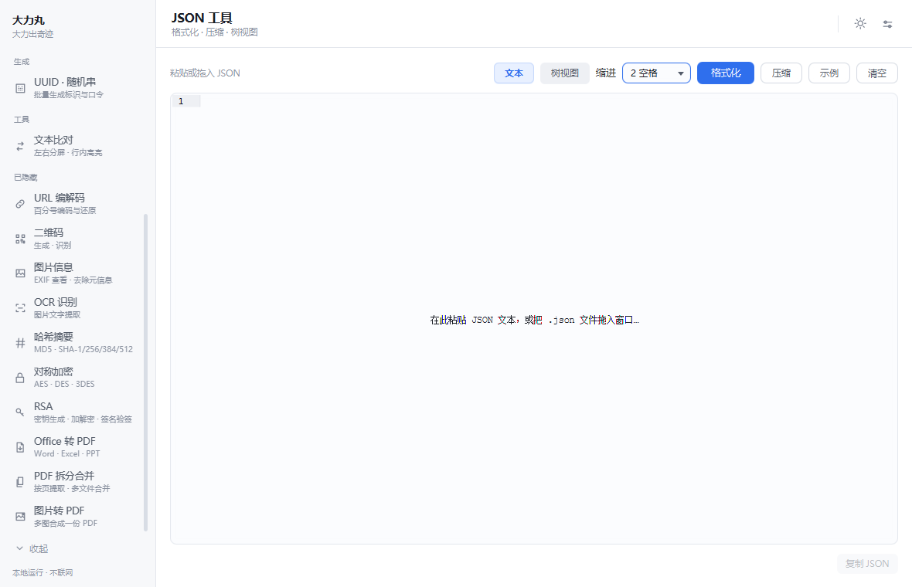

### MyBatis SQL

把 DEBUG 日志里那两行 `Preparing` / `Parameters` 直接还原成能执行的 SQL，不用再对着 `?` 数参数：

```text
==>  Preparing: select user_id, user_name from t_user where delete_flag = ? and status = ?
==> Parameters: N(String), 01(String)
```

上方粘日志、下方出结果，参数按日志里的类型还原（`01(String)` 会写成 `'01'`，不会被当成数字 `1`）：

```sql
SELECT
  user_id,
  user_name
FROM
  t_user
WHERE
  delete_flag = 'N'
  AND status = '01'
ORDER BY
  created_date DESC
```

| 能力 | 说明 |
| --- | --- |
| 日志还原 | 整段日志粘进来即可，时间戳、级别、Logger 名都不影响；按 `?` 顺序填参 |
| 类型还原 | 字符串加引号、数字不加、`null` 写 `NULL`、`Timestamp` 自动去掉毫秒尾巴 `.0` |
| 多语句 | 一次粘贴多段（例如批量 insert），多条之间补分号，整段可直接执行 |
| 集合展开 | `[11, 22](ArrayList)` 按元素展开，对上 foreach 生成的多个 `?` |
| 转义 | `O'Brien` → `'O''Brien'`；值里自带的 `?` 不会被当作占位符 |
| 格式化 | 内置 sql-formatter，MySQL / PostgreSQL / Oracle / SQL Server / 标准 SQL 五种方言，关键字可大写 |
| 语法着色 | 结果区带行号，关键字、函数、字符串、数字、注释分色显示，明暗主题各一套配色 |
| 容错 | 参数与 `?` 数量不一致时，状态栏指出是哪条语句、差几个 |
| 快捷键 | `Ctrl + Enter` 立即拼接；`.log` 文件也能直接拖进来 |

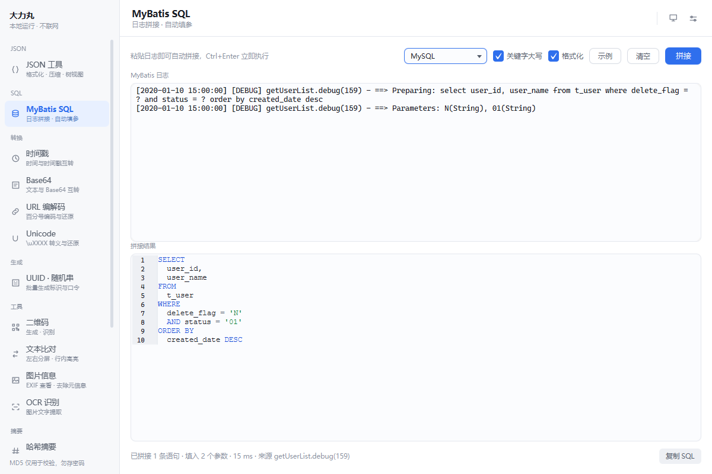

### 摘要

支持 **MD5、SHA-1、SHA-256、SHA-384、SHA-512** 五种算法，文本与文件共用同一页面：

| 能力 | 说明 |
| --- | --- |
| 文本计算 | 输入即算，180ms 防抖；字符统一按 UTF-8 编码 |
| 文件计算 | 拖拽入窗或按钮选择；64KB 缓冲流式读取，内存占用与文件大小无关 |
| 输出形式 | Hex 小写、Hex 大写、Base64；MD5 额外提供 16 位截取形式 |
| 进度反馈 | 大文件计算时显示进度条与耗时 |

### 加密

**对称加密**：AES-128 / AES-192 / AES-256 / DES / 3DES，支持 ECB 与 CBC 模式，密钥与初始向量可选用文本或十六进制输入，密文支持 Base64 与十六进制输出。

| 细节 | 行为 |
| --- | --- |
| 填充 | 统一 PKCS5Padding（对 AES 等价于 PKCS7），明文长度无需对齐块大小 |
| 密钥校验 | 输入时实时显示「当前字节数 / 所需字节数」，不匹配直接拒绝，不做静默补齐 |
| 错误提示 | 密钥不匹配、密文损坏、编码非法分别给出可读原因 |

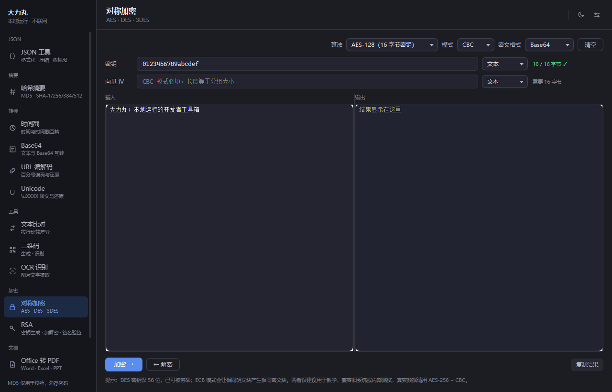

**RSA**：密钥对生成（2048 / 3072 / 4096 位）、公钥加密 / 私钥解密、私钥签名 / 公钥验签（SHA256withRSA）。

| 细节 | 行为 |
| --- | --- |
| 分段加密 | RSA 单块上限为「密钥字节数 − 11」（2048 位约 245 字节），本实现自动切块，超长明文无需调用方处理 |
| 密钥格式 | 输出 PKCS#8 私钥 + X.509 公钥的 PEM；解析时同时兼容 OpenSSL 传统的 PKCS#1 私钥 |
| 签名算法 | SHA256withRSA，签名值 Base64 |
| 交互 | 点击「私钥签名」后签名值自动填入验签输入框，便于立即校验 |

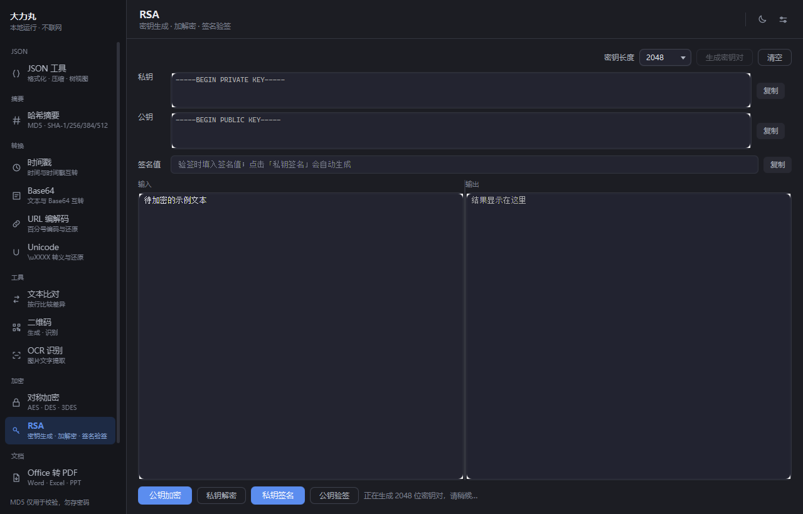

> DES 密钥仅 56 位，现代硬件可穷举；ECB 模式会让相同明文块产生相同密文块并泄露结构。两者仅建议用于教学、兼容旧系统或内部测试，真实数据请用 AES-256 + CBC。

### 编码

| 页面 | 能力 |
| --- | --- |
| Base64 | 一页两模式。**文本**：文本与 Base64 互转，标准与 URL-safe（`-_`、无填充）两种字母表，字符集可选 UTF-8 / GBK / GB18030 / ISO-8859-1，解码容忍换行与字母表混用；**图片**：图片与 Base64 / Data URI 双向互转，纯 Base64 与 `data:image/png;base64,…` 可切换，类型以文件头为准、扩展名兜底，粘贴 Data URI 即预览并可另存，解出来不是图片会明确报错 |
| URL 编解码 | 表单编码（空格 → `+`）与 RFC 3986（空格 → `%20`）两种规则，路径与查询参数场景不同，故显式选择 |
| Unicode | 中文与 `\uXXXX` 互转；可选「仅非 ASCII / 全部字符」与十六进制大小写；emoji 以代理对形式正确往返 |

Base64 页顶部切换「文本 / 图片」——两者本质是同一件事，只是字节来源不同：文本按所选字符集编码取字节，图片直接取文件字节再额外识别 mime。拆成两个导航项，等于让人在两个页面之间来回找。

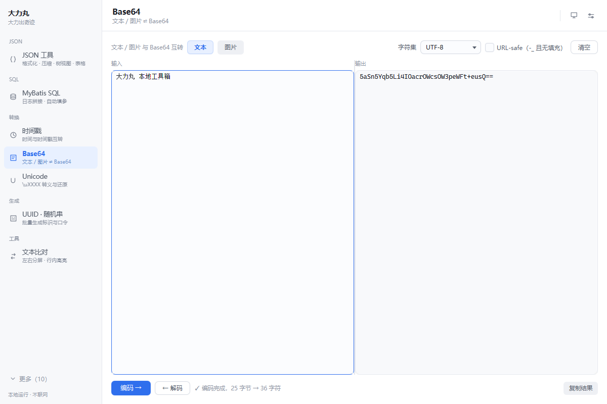

图片模式内部再分「图片 → Base64」与「Base64 → 图片」两个方向：编码侧选图或拖入即出结果，解码侧粘贴 Data URI 即预览并可另存。输出区只渲染前 20 万字符，一张几 MB 的图编出来是上百倍长度的文本，整段塞进文本框会让界面停好几秒，而这时用户真正要的是「复制」而不是「看」。

长串按窗口宽度折行显示，不用横向拖着看。折行只在显示层：`getText()` 和「复制」拿到的仍是连续的一整行，粘到代码或配置里不会被多出来的换行打断。在 20 万字符上限内，折行布局约 40 ms，代价可以忽略。

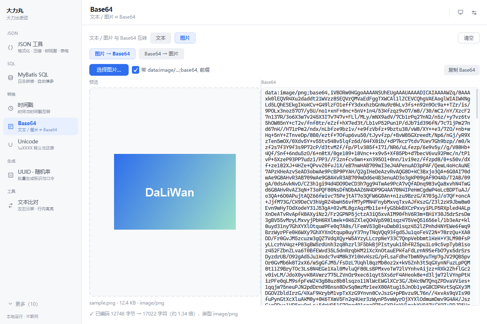

### 生成

**UUID · 随机串**：UUID（v4）批量生成，可选保留连字符与大写；随机字符串支持自定义长度（1~256）、字符集（数字/小写/大写/符号）与「排除易混淆字符」（剔除 0/O/o、1/l/I），数量可选 1~100，生成使用 `SecureRandom`。全部为本地计算，适合生成测试数据、接口联调 ID 与临时口令。

### 工具

**时间戳**：当前时间戳每秒刷新（秒与毫秒并列）；时间戳 → 日期（6 个常用时区，输出标准格式、ISO 8601、RFC 1123、UTC 四种表示）；日期 → 时间戳（自动识别 `yyyy-MM-dd HH:mm:ss`、`yyyy/MM/dd`、ISO 8601 等格式）。

**二维码**：文本与二维码互转，输入即生成，可保存为 PNG 或复制到剪贴板，也支持从图片反向识别。保存用的是自带的 `PngEncoder`（只依赖 `java.util.zip`），不走 `ImageIO`——`ImageIO.write` 找不到编码器时**只返回 false 不抛异常**，依赖它就会出现「点了保存却没反应」。

| 细节 | 行为 |
| --- | --- |
| 参数 | 尺寸 256–1024、容错 L/M/Q/H、前景与背景色可调 |
| 编码 | 内容按 UTF-8 编码，中文不会乱码；超出约 2900 字节时给出明确提示 |
| 识别 | 先铺白底再二值化，因此带透明通道的 PNG 也能识别 |
| 渲染 | 关闭平滑缩放，保持点阵锐利，避免缩放后边缘模糊影响扫码 |

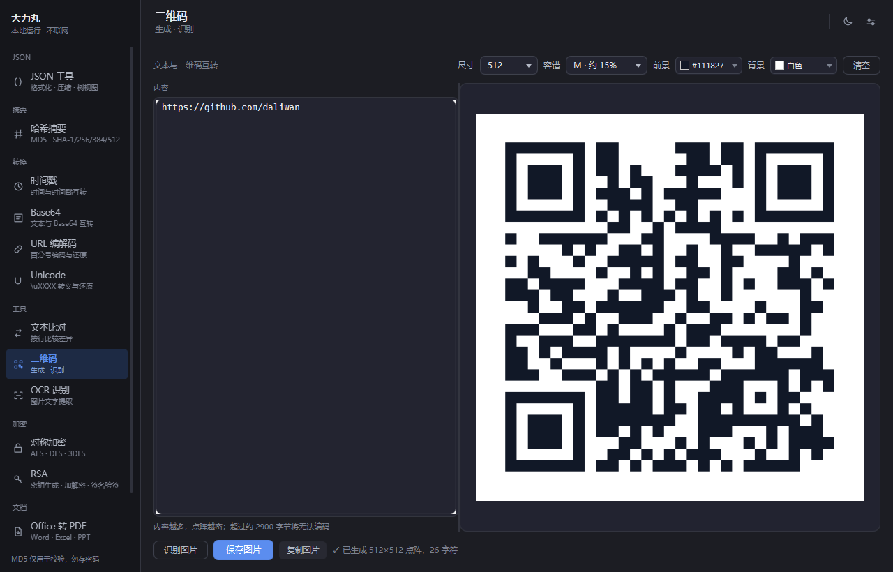

**OCR 识别**：选择或拖入图片，用内置的 RapidOCR（PP-OCRv4）提取文字，中英文混排效果好，**无需安装任何外部程序**。可勾选「自动纠正方向」处理旋转过的图片。

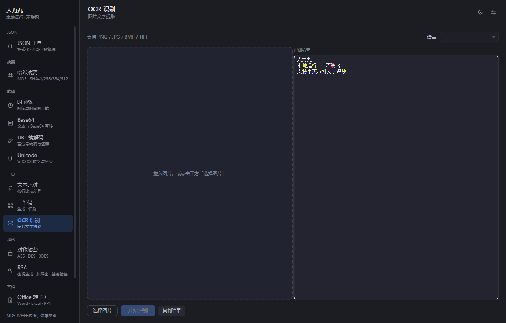

**图片信息**：拖入或选择图片，读取 EXIF / IPTC / XMP / GPS 等元数据：概要（尺寸、宽高比、百万像素、相机、拍摄时间、GPS 坐标）置顶，其余按分组列出全部标签，一键复制成纯文本。JPEG / PNG / GIF / WebP / BMP / TIFF / HEIC 等常见格式都能读，HEIC 这类系统预览不了的格式照样出元数据。

页面上还有「去除元信息」：把 EXIF / XMP / IPTC / 注释这些隐私内容从文件里摘掉，再发到群里或上传图床就不带拍摄设备、时间和 GPS 了。JPEG / PNG / WebP / GIF 是**按容器结构剪裁**——只摘掉承载元数据的块，像素数据一个字节都不动，所以没有画质损失、体积只减不增；TIFF / BMP 这类剪不出独立元数据块的才退回重编码，并明确提示。三个方向策略可选：默认「保留方向」只留下 26 字节的 Orientation 标记（否则手机照片会横躺），也可以「直接丢弃」或「摆正像素」。默认保留 ICC 色彩配置（不含隐私，删了广色域照片会偏色）。支持一次拖入多张批量处理，逐条回显移除了什么、体积变化、输出路径，单个失败不影响其余；**原图始终不改**，输出统一加 `_clean` 后缀。

**文本比对**：IDEA git 比对式左右分屏——两栏行行对齐、同步滚动，删除行红色、新增行绿色、补位行灰色，配对成功的「修改行」再做字符级高亮，一眼看出改了哪几个字。变更块里删除与新增数量不同时按**相似度**配对（改了参数的行会越过邻近的新增行，和真正对应的那行配上），长行不截断、横向滚动查看。输入即自动比对（200ms 防抖），可勾选忽略空白差异。底层是 Myers 差分算法，长文本也不会卡。

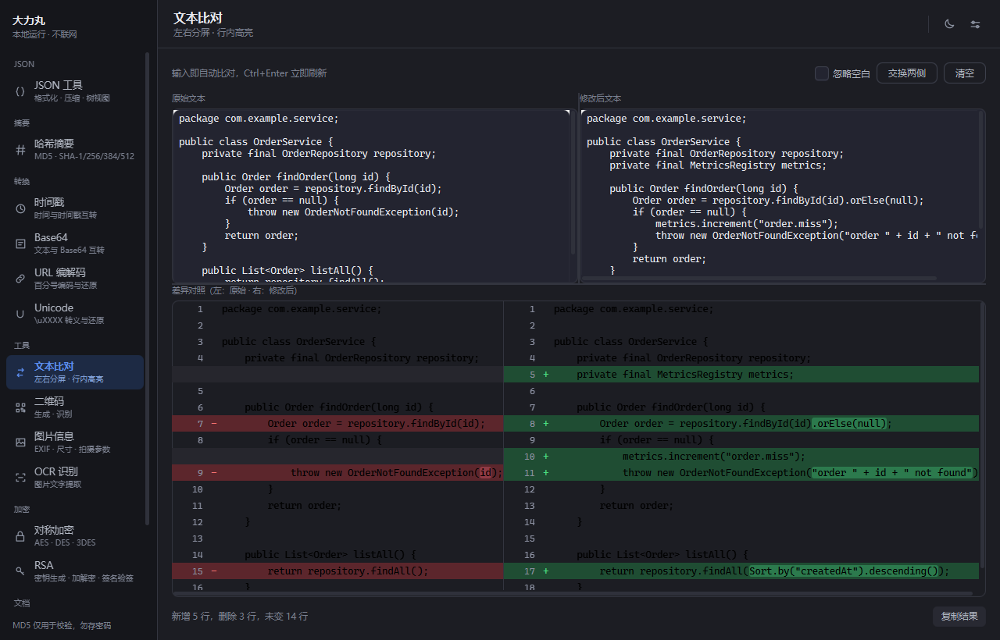

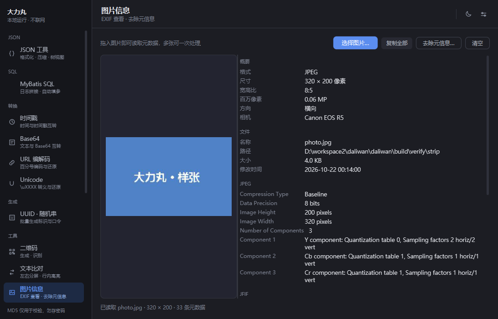


### 文档

| 页面 | 能力 |
| --- | --- |
| Office 转 PDF | Word / Excel / PPT / CSV 批量转换，支持拖入，逐条显示成功与失败原因；可挂到右键菜单 |
| PDF 转 Office | PDF 反解成 Word / Excel / PPT / 纯文本，目标格式下拉可选，同样支持拖入与右键菜单 |
| PDF 拆分合并 | 按页码范围拆分（`1-3,5,7-9`），或多份 PDF 按顺序合并 |
| 图片转 PDF | 多张图片合成一份 PDF，每图一页，可调整顺序 |

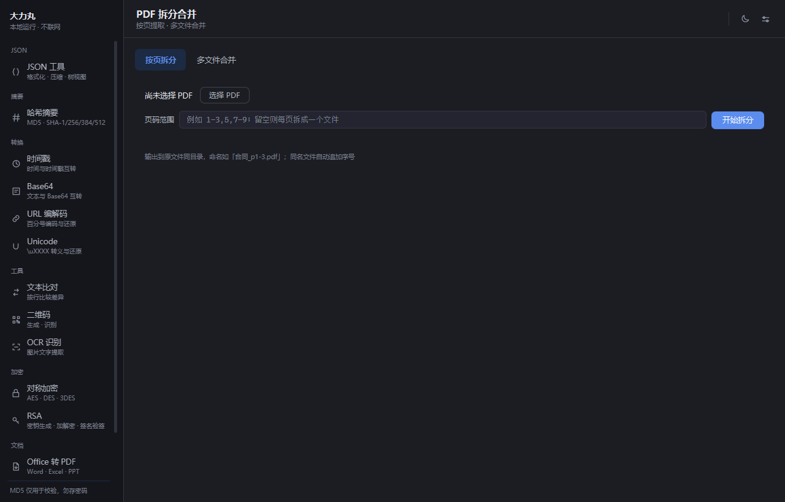

> 两个方向的文档互转都由**内置的 Stirling Office Convert**（MIT 开源）完成，不需要装 Office，
> 也不需要 LibreOffice：PDFBox + Apache POI 纯 Java 渲染，无水印、无外部进程。
> 引擎按 Java 25 编译，构建与打包需要 JDK 25；低版本 JDK 上引擎不可用，
> 会自动退回 LibreOffice（如果装了）。
>
> 区别在于保真方向：Office → PDF 是「渲染」，排版所见即所得；
> PDF → Office 是「反解」，段落、标题、列表、表格会还原成真的 Office 元素，
> 但复杂版式（多栏混排、艺术字、手写批注）只能近似——**转出来的是可编辑内容，不是像素级复刻**。
> 与 PDF 拆分合并（纯结构操作，装好即可用）不同，排版引擎决定转换保真度。

### JSON

一页做四件事：格式化 / 压缩、语法校验、树视图浏览、数组转表格。同一块区域在 **文本 / 树视图 / 表格** 三个形态间切换，文本是唯一数据源：

| 形态 | 能力 |
| --- | --- |
| 文本 | 可编辑的高亮代码框（**行号栏 + 语法高亮**）；格式化 / 压缩原地替换框内内容，可 `Ctrl + Z` 撤销；2/4 空格、Tab 三种缩进；输入时实时校验并提示错误行列；`Ctrl + Enter` 快捷格式化。大 JSON 也不怕：编辑框走虚拟滚动（右侧始终有滚动条），20 万字符以内整篇着色，超过后只给「看得见的那些行」上色、滚动停下再补——80 万字符 / 4.4 万行实测加载 0.13 s，着色、行号、滚动条一样不少 |
| 单行大 JSON | 接口返回常常是**一整行**的压缩 JSON，这种形态着色会把界面卡死（15 万字符的单一行着色要近 10 秒，之后每敲一个字都重来）。所以单行超过 8 000 字符时自动**暂停着色**并在状态栏提示「点『格式化』展开后恢复」——展开成多行后着色照常；实测 15 万字符单行的载入从 74 秒降到 0.15 秒 |
| 树视图 | 切过去即按当前文本解析，不用点「生成树」；逐层展开、键名 + 类型徽章 + 值预览；展开/折叠全部；右键复制 JSONPath / 键名 / 值（字符串复制时去掉双引号并还原转义，且不按预览截断）；右键**删除此节点**（连同子树，改的是文本） |
| 表格 | **自动找表格数据**：接口返回多半是 `{"code":0,"data":{"list":[…]}}` 这种包裹结构，会自己下钻到最像表的那段数组（对象数组优先，其次列多、行多、层级浅），状态栏写明「数据来自 data.list」；全文不止一处数组时，状态栏右侧出现**数据源下拉**，点开即可在几处数组间切换，不用改 JSON 本身；列取所有键名的并集、缺字段留空、首列行号；嵌套对象 / 数组还原成紧凑 JSON 放在单元格里（展开成 `a.b.c` 遇到数组就会无限膨胀）；导出**默认给 Excel（.xlsx）**——CSV 在中文 Excel 里会踩编码、逗号、长数字变科学计数法的坑，xlsx 里数字与文本各归各位；表头 11 号字白底、列宽按内容自动撑开；CSV 仍保留（UTF-8 带 BOM） |

表格视图超过 5000 行或 200 列时只渲染一部分，并在状态栏说明「共 N 行，只显示前 5000 行」——这个上限是给 TableView 兜底的，数据本身没有被截断在解析层。

删节点走的也是文本：解析成可变的文档模型、按位置删掉，再按原排版写回去（原文单行就保持单行，多行则沿用它的缩进），最后重建树；**删了就删，不弹确认**——右侧树里本来就有「改的是文本、可 `Ctrl + Z` 撤销」的兜底，多问一遍反而碍事，根节点不可删。JSON 允许重复键，所以定位用的是「第几个成员 / 第几个元素」而不是键名——否则同名键会删错。重复键与数字字面量在写回时都原样保留。

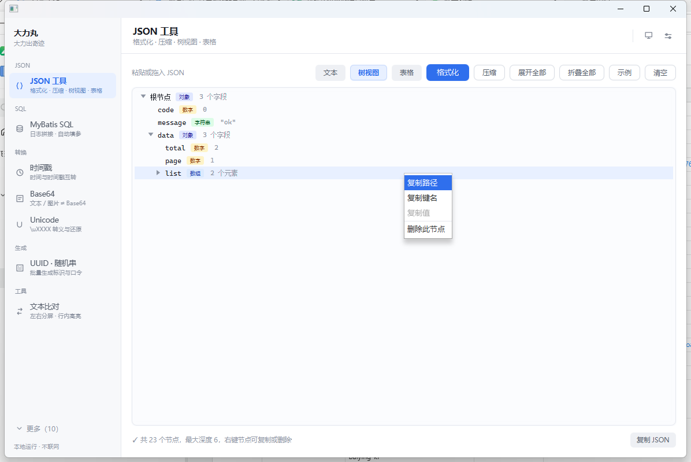

三种形态都支持拖入 `.json` 文件（拖入后直接以树视图呈现）；状态栏可一键复制全部 JSON。读盘与解析都在后台线程做，几 MB 的大文件拖进来也只是状态栏显示「正在解析…」，界面不会假死；树子节点按需创建，几万节点也不会卡。

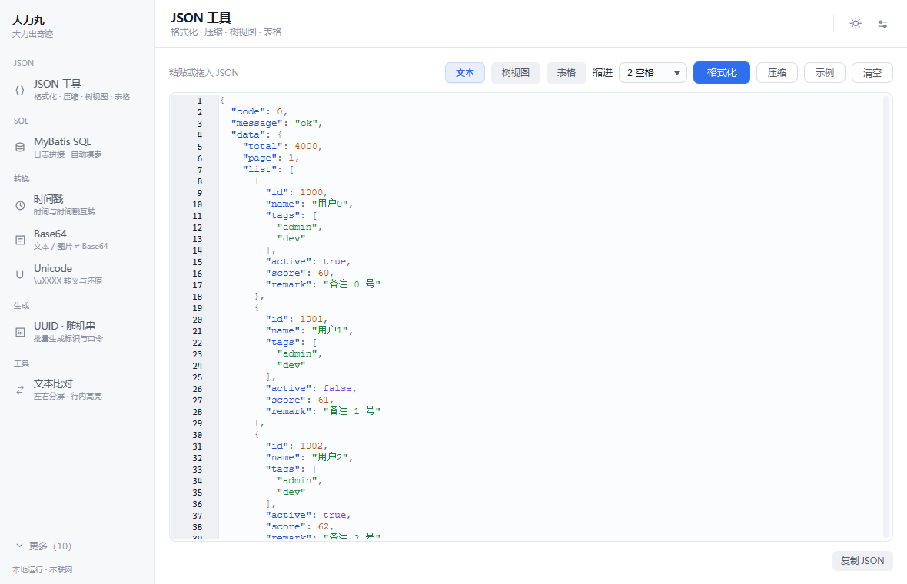

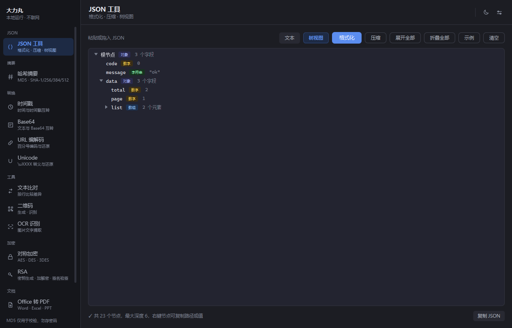

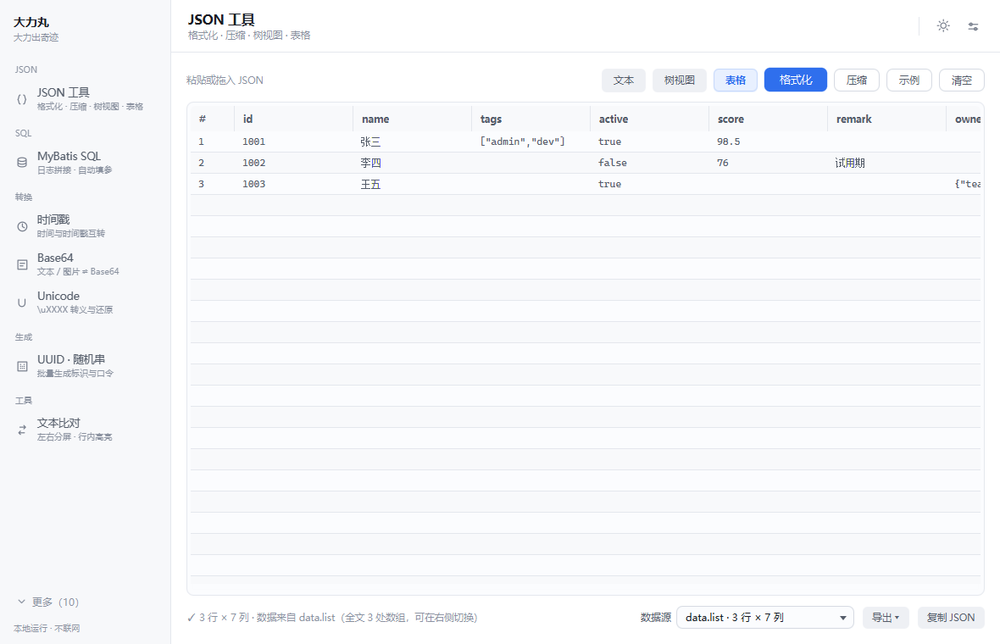

格式化器的关键特性（区别于多数在线工具）：

- **字段顺序原样保留**，不按字母重排
- **重复键原样保留**，不合并、不丢弃
- **数字字面量原样保留**：`9007199254740993` 不被截断，`1.50`、`1e10` 的写法也不被改写

---

## 环境要求

- JDK 25 或更高（`maven.compiler.release=25`；Stirling 引擎按 Java 25 编译）
- Maven 3.9+

## 运行

### 方式一：脚本

```bat
run.bat
```

脚本按顺序查找 Maven：`D:\soft\apache-maven-3.9.6` → `D:\soft\apache-maven-3.9.9` → `C:\Program Files\apache-maven-3.9.9` → 系统 `PATH`。若都不匹配，直接编辑 `run.bat` 中的 `MVN` 变量。

### 方式二：命令行

```bash
mvn javafx:run
```

### 方式三：IntelliJ IDEA

1. `File → Open` 选择本目录，按 Maven 项目导入
2. 右侧 Maven 面板 → `Plugins` → `javafx` → 双击 `javafx:run`

> 不要直接右键运行 `DaliwanApplication.main()`。非模块化工程下直接运行 Application 子类会报 "JavaFX runtime components are missing"，因此 `pom.xml` 中配置的启动类是 `Launcher`，由它转调 `DaliwanApplication`。

## 界面设置

点击右上角的设置图标，会在右侧内容区直接打开设置页（不弹独立窗口），保存后左侧导航立即刷新，并自动回到进入前的页面。

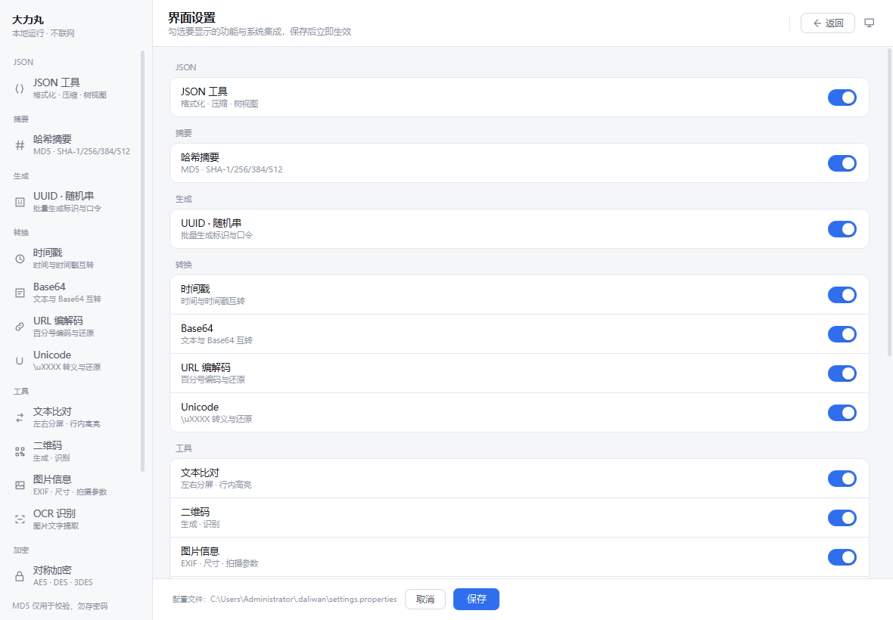

**主题切换**：标题栏右侧的图标按「跟随系统 → 浅色 → 深色」循环切换（图标分别是显示器 / 太阳 / 月亮），选择随界面设置一起保存。默认是**跟随系统**：启动时读 Windows 的 `AppsUseLightTheme`，窗口重新获得焦点时再读一次，因此在系统设置里切换明暗后切回窗口即可生效，不必重启。

**还原默认值**：页脚的「恢复默认」和「取消 / 保存」放在一起，一次把所有开关拨回初始状态——导航项全部显示、系统集成三项全部关闭。点它会先在本页盖一层确认卡片（不另开系统对话框）：卡片用的是同一套配色与按钮，遮罩外点一下或按 `Esc` 都算取消。还原只改界面上的开关，点「保存」才写配置与注册表，因此误点了直接「取消」即可；保存时若原本开着右键菜单，会走和手动关闭同一条路径把注册表项一并清掉。主题不在这页，所以不受影响。


**关于**：右上角设置按钮旁边的 ⓘ 按钮弹出「关于」窗口——版本号（打包时从 jar 清单读取，开发期退回固定值）、Java 运行时与操作系统、配置文件路径、「本地运行，不联网」的说明、以及第三方组件（Stirling Office Convert、Apache Fesod / POI、PDFBox、Jackson、RichTextFX、ZXing、RapidOCR）各自按其许可证使用。左下角有「复制版本信息」按钮，反馈问题时一键把排障信息整段复制走；`Esc` 或「关闭」退出。数据统一放在 `core/AppInfo`（纯 Java，可单测），弹窗只负责排版。

**窗口尺寸**：初始宽高取屏幕可用区域的 62% × 84%，并限制在 880×620 到 1600×1000 之间，同时保证不超出可用区域；最小尺寸也随屏幕收缩，小屏上仍可继续缩小窗口。

**资源管理器右键菜单**（设置页「系统集成」组）是两个独立开关，都只写当前用户的注册表，不需要管理员权限。
不管挂了几个动作，右键里**只多出一个「大力丸」**，具体动作收在它的二级菜单里：

| 开关 | 出现在哪些文件上 | 一级菜单 | 展开后的动作 | 结果 |
| --- | --- | --- | --- | --- |
| Office 转 PDF | `.doc` `.docx` `.rtf` `.odt` `.xls` `.xlsx` `.xlsm` `.xlsb` `.csv` `.ods` `.ppt` `.pptx` `.pptm` `.pps` `.ppsx` `.odp` | 大力丸 | 转 PDF | 源文件旁边生成同名 PDF |
| PDF 转 Office | `.pdf` | 大力丸 | 转 Word / 转 Excel / 转 PPT / 提取文本 | 分别生成 `.docx` / `.xlsx` / `.pptx` / `.txt` |

点一下即在源文件所在目录生成结果，同名文件自动加序号，绝不覆盖。程序目录搬家后，启动时会按当前路径重写一遍注册表，不用手动再开一次开关。

> 菜单项是「动词」驱动的（一个动作 = 一个注册表子键 + 一条命令行 + 一组扩展名），
> 见 `core/shell/ContextMenuIntegration`：要加新格式，往 `PDF_TO_OFFICE` 里加一项即可，
> 安装脚本、卸载脚本与 `.reg` 兜底都会自动跟上。
>
> 子菜单在 Windows 上有两种写法，各有一半机器只认其中一种，所以两套都写：
> 父键 `SubCommands` 置空 + 父键自带 `Shell` 子键（全部在 HKCU 内，不需要管理员），
> 以及 `ExtendedSubCommandsKey` 指向 `Software\Classes\DaliwanMenu\<扩展名>` 这个按扩展名分开的
> 集中键（这样 `.pdf` 的子菜单里不会冒出「转 PDF」这种没意义的项）。
> 另外安装时会顺手清掉旧版平铺的键，避免右键里同时出现两套菜单。

Win11 换了新的精简右键菜单，只认实现了 `IExplorerCommand` 并带包标识的 COM 扩展，传统 `shell\command` 注册一律被折进「显示更多选项」（26H2 起还要先在上层菜单里把这一项打开才看得到）。绿色版不打包 MSIX，因此同一组里还有第二个开关：打开后往 `HKCU\Software\Classes\CLSID` 写一个指向空 `InprocServer32` 的键，外壳便退回经典菜单，这一项就直接出现在第一层。改完点「立即重启」重启一次资源管理器即可；关掉开关会删掉整棵键、恢复 Win11 默认外观。不想改菜单样式的话，`Shift + 右键`（或 `Shift + F10`）每次都能直接调出经典菜单。

**这个开关的代价是全局的**，所以默认关闭，勾选后保存时还会再弹一次确认：换掉的是整个系统的菜单样式，所有程序的右键都会变回 Win10 那种长菜单，不只是本软件，用户装的其他右键扩展也会跟着换位置。说白了它绕开的是微软的准入条件，而不是实现了 `IExplorerCommand`——真要进 Win11 新菜单第一层，得额外发布一个 native COM 组件、打 sparse MSIX 包、还要让用户信任一张证书，对这个工具的定位不划算。


确认框的默认按钮放在「取消」上，误按回车不会改动系统；设置页里也直说了「代价是把整个系统换回 Win10 的长菜单」。


- 注册位置在 `HKEY_CURRENT_USER\Software\Classes\SystemFileAssociations\<扩展名>\shell\DaliwanToPdf`，**只动当前用户、不需要管理员权限**，也不会改这些文件类型的默认打开方式；关掉开关会把这一层键整棵删掉。
- 写入走 PowerShell（一次调用写完所有扩展名，并调用 `SHChangeNotify` 让资源管理器立刻刷新；PowerShell 被策略挡住时退回 `reg import`）。桌面版程序会把 `大力丸.exe` 连同图标写进命令；开发期 `java -jar` 运行时写的是 `javaw.exe -jar …daliwan_tool.jar`。
- 多选文件时资源管理器会对每个文件各调一次命令，多个请求会用一个本地套接字（`127.0.0.1` 随机端口，端口号记在 `~/.daliwan/instance.port`）并到已打开的实例上——只是借它的进程省掉几次启动，转换在那个实例的后台线程里跑，**不切页面、不把窗口拽到前台、不抢焦点**；转完照旧弹右下角那张独立结果卡片（自绘圆角 + 阴影，淡入上浮，配色跟随程序主题；鼠标移入暂停，12 秒后自动淡出）。程序没开时则是自己转完弹同样的卡片，两种情况下用户看到的东西完全一致。
- 主窗口启动时会比对注册表里记的命令行与当前路径，绿色版目录搬家后会自动重写；`~/.daliwan/convert.log` 记录每次转换的结果与耗时。
- Windows 11 把它收在「显示更多选项」里（系统只给 MSIX 打包的程序开放新版一级菜单），属于系统行为。

配置文件里对应的两项是 `shell.pdf.menu` 与 `shell.pdf.menu.command`（后者记录上次写入的命令行，用于判断程序是否被移动过）。

配置保存在纯文本文件里，方便备份与手工修改：

```properties
# Windows: C://Users//<用户名>//.daliwan//settings.properties
nav.hidden=rsa,ocr
ui.theme=system
ui.theme.explicit=true
shell.pdf.menu=true
shell.pdf.menu.command="C:\\Tools\\daliwan_tool\\大力丸.exe" --to-pdf "%1"
```

`nav.hidden` 只记录**被隐藏**的项，因此后续版本新增的功能默认可见，不会因为升级而消失。`ui.theme` 取值为 `system` / `light` / `dark`；只有手动选过主题才会写 `ui.theme.explicit=true`，旧版本留下的 `ui.theme=dark` 没有这个标记，升级后按「跟随系统」处理。删掉该文件即可恢复全部显示与默认主题。

## 测试

```bash
mvn test
```

共 **297 个用例**，全部基于标准向量与边界条件：

| 测试类 | 用例数 | 覆盖内容 |
| --- | --- | --- |
| `DigestServiceTest` | 12 | RFC 1321、FIPS 180-4 标准向量、空文件、中文、16 位截取规则、Base64 派生、流式进度 |
| `JsonFormatterTest` | 13 | 嵌套结构、空容器、压缩、数字保真、键序与重复键、Unicode 转义、错误行列、多顶层值 |
| `JsonTreeBuilderTest` | 14 | 节点类型、路径拼接、特殊键名、空容器、长值截断、非法 JSON |
| `JsonTableTest` | 13 | 对象数组并集列、缺字段补空、标量数组单列、嵌套还原紧凑 JSON、字符串转义、顶层对象单行、空数组、顶层标量报错、行列截断、CSV 转义与表头 |
| `JsonTableAutoTest` | 13 | 包裹结构下钻 data.list、顶层数组不猜、对象数组优先、取列多者、标量数组退单列、无数组退单行、不进入数组内部、空数组、深层路径、候选携带路径与标签、按候选定点转换、顶层标量报错、重复键安全 |
| `XlsxExporterTest` | 5 | 表头与数据行、数字列转数值（前导 0 与超长数字留文本）、非法字符工作表名兜底、写出后可再读回、空表 |
| `JsonDocumentTest` | 12 | 删对象成员 / 数组元素 / 嵌套节点、删空容器、根节点拒删、失效路径、重复键保留、数字字面量保真、字符串转义、缩进风格、写回可再解析、非法输入 |
| `UnicodeCodecTest` | 9 | 转义范围、大小写、代理对往返、非法序列保留 |
| `UrlCodecTest` | 8 | 两种规则的编码与还原、`+` 语义差异、小写转义、残缺序列 |
| `ToolSettingsTest` | 13 | 默认全可见、隐藏项持久化、重新显示、UTF-8 可读性、父目录自动创建、主题默认跟随系统、旧版深色视为默认值、手动选择持久化、非法主题被忽略 |
| `SystemThemeTest` | 3 | 系统配色探测不抛异常、注册表输出解析（0 深色 / 1 浅色）、键缺失时退回浅色 |
| `QrCodeServiceTest` | 9 | 点阵尺寸、英中/多行往返、高容错、容量上限、空白图与透明 PNG 识别 |
| `TextDiffTest` | 16 | 增删改识别、行号、中文与 CRLF、200 轮随机文本的双向重建、左右行对齐与修改对配对、相似度配对、行内差异片段、忽略空白 |
| `ImageMetaServiceTest` | 5 | PNG 尺寸与格式、概要分组、手搓 EXIF 段的 Make 标签、非图片报错、文件大小格式化 |
| `ImageMetaStripperTest` | 10 | JPEG 剪裁后相机信息消失但保留方向、丢弃方向后无 EXIF、ICC 保留/移除、PNG 文本块与 eXIf、WebP 块与 RIFF 长度重算、GIF 注释扩展、BMP 重编码兜底、原地覆盖、非图片报错 |
| `ImageBase64CodecTest` | 15 | PNG 编码与 data URI、文件头优先于扩展名、扩展名兜底、data URI 与纯 Base64 解码、带换行、编解码往返、非图片拒绝、非法 Base64、空内容、缺逗号、文本编码 Data URI 拒绝、SVG、WebP 双条件匹配、扩展名映射、体积倍数 |
| `PdfSplitterTest` | 10 | 页码解析、越界报错、按页/按范围拆分、防覆盖（用页面宽度校验页码） |
| `PdfOperationTest` | 10 | 合并页数与顺序、图片成页尺寸、格式校验、合并后再拆分 |
| `SymmetricCipherTest` | 14 | 与 OpenSSL 对照的固定向量、全算法全模式往返、密钥与向量长度校验、错误密钥提示 |
| `RsaServiceTest` | 12 | 密钥对生成、短/长明文分段往返、密文随机性、签名验签与篡改检测、OpenSSL PKCS#1 私钥互操作 |
| `StirlingEngineTest` | 4 | 引擎扩展名清单、`.wps` 不注册、`supports` 匹配、可用性与 JDK 版本一致 |
| `PdfToOfficeConverterTest` | 7 | 开关反查目标格式、扩展名识别、输出命名与防覆盖、真实 PDF 转 docx / txt、组件不可用时的提示 |
| `OfficeCommandTest` | 4 | `--to-*` 开关识别与取值、文件参数收集、开关清单与转换目标一致 |
| `MybatisLogParserTest` | 11 | Preparing/Parameters 定位、续行拼接、多语句、集合参数展开 |
| `SqlAssemblerTest` | 13 | 占位符顺序替换、引号与 NULL 处理、跳过字符串与注释里的问号、方言差异 |
| `SqlHighlighterTest` | 12 | 关键字/函数/字符串/数字分类、字面量与关键字区分、字符串内关键字不被切开、转义引号、行注释与块注释、反引号标识符、数字与指数、token 升序不重叠、中文标识符、真实拼接结果着色 |
| `OcrServiceTest` | 5 | 引擎可用性、中英识别、空白图 |
| `RandomServiceTest` | 9 | UUID 格式与批量、字符集、排除易混淆字符、长度边界 |
| `PdfCommandTest` | 4 | 命令行参数解析、批量转换、失败信息 |
| `ContextMenuIntegrationTest` | 19 | 两级菜单的父键 / 二级子键 / 集中键生成、`SubCommands` 空值与 `ExtendedSubCommandsKey`、旧键清理、卸载与 .reg 兜底 |
| `Win11MenuTest` | 10 | CLSID 键路径、构建号解析（含 BOM / 空行 / 报错文本里的假数字）、HKCU 路径转换、安装与卸载脚本互为镜像、资源管理器重启脚本 |
| `FileNamesTest` | 5 | 后缀大小写、重名追加序号、无扩展名 |
| `PngEncoderTest` | 4 | 编码可解码、尺寸与像素一致 |

## 目录结构

```
daliwan_tool/
├── pom.xml
├── run.bat                        源码方式启动
├── build-jpackage.bat             一键打包为绿色版 exe
├── README.md
├── tools/
│   ├── icon-source.png            图标源图（写实羊角锤产品图，白底）
│   ├── build_icons.py             图标打包流水线（抠除白底 + 合成蓝色圆角底 + 7 档 PNG + ICO）
│   ├── zip_app.py                 把 dist/daliwan_tool 压成分发包
│   ├── check_exe_icon.py          校验 exe 里嵌的图标与源图是否一致
│   └── *Smoke.java / *Check.java   文档转换、右键菜单、界面截图的命令行验证脚本（不参与打包）
├── docs/                          界面截图
└── src/
    ├── main/
    │   ├── java/com/daliwan/tool/
    │   │   ├── Launcher.java              启动入口（规避 classpath 下的组件缺失检查）
    │   │   ├── DaliwanApplication.java        JavaFX Application
    │   │   ├── core/                      纯逻辑，无 JavaFX 依赖，可单独测试
    │   │   │   ├── DigestService.java     文本 / 字节 / 文件流式摘要
    │   │   │   ├── HashAlgorithm.java     MD5 与 SHA 系列算法定义
    │   │   │   ├── HashResult.java        摘要结果与派生形式
    │   │   │   ├── JsonFormatter.java     JSON 格式化 / 压缩 / 校验
    │   │   │   ├── JsonTreeBuilder.java   JSON 解析为节点树
    │   │   │   ├── JsonDocument.java       可修改的 JSON 文档（删节点写回）
    │   │   │   ├── JsonTable.java          JSON 数组转表格、自动定位与候选枚举
    │   │   │   ├── XlsxExporter.java       表格写出 .xlsx（fesod，数字列自动转数值）
    │   │   │   ├── JsonTreeNode.java      树节点模型
    │   │   │   ├── JsonFormatException.java  带行列号的语法异常
    │   │   │   ├── IndentStyle.java       缩进风格
    │   │   │   ├── UrlCodec.java          表单与 RFC 3986 编码
    │   │   │   ├── SymmetricCipher.java   AES / DES / 3DES 加解密
    │   │   │   ├── CipherException.java   加解密异常
    │   │   │   ├── RsaService.java        RSA 密钥 / 加解密 / 签名
    │   │   │   ├── UnicodeCodec.java      Unicode 转义与还原
    │   │   │   ├── QrCodeService.java     二维码生成与识别
    │   │   │   ├── PngEncoder.java        极简 PNG 编码器（二维码保存用）
    │   │   │   ├── QrCodeException.java   二维码异常
    │   │   │   ├── RandomService.java     UUID 与随机字符串生成
    │   │   │   ├── TextDiff.java          Myers 行级差分 + 左右行对齐
    │   │   │   ├── ImageMetaService.java  图片元数据（EXIF / GPS / 尺寸）
    │   │   │   ├── ImageMetaStripper.java 去除元信息（JPEG/PNG/WebP/GIF 结构剪裁 + 重编码兜底）
    │   │   │   ├── OcrService.java        内置 RapidOCR（PP-OCRv4）识别
    │   │   │   ├── OcrException.java      OCR 异常
    │   │   │   ├── ToolSettings.java      界面偏好（导航隐藏项 / 主题 / 右键菜单）持久化
    │   │   │   ├── sql/                   MyBatis 日志还原 + SQL 美化
    │   │   │   │   ├── MybatisLogParser.java   解析 Preparing / Parameters（含集合展开）
    │   │   │   │   ├── SqlAssembler.java       按顺序替换 ?（跳过字符串与注释里的问号）
    │   │   │   │   ├── ParamValue.java         参数值 → SQL 字面量（类型决定引号）
    │   │   │   │   ├── SqlBeautifier.java      sql-formatter 封装 + 失败兜底
    │   │   │   │   ├── SqlHighlighter.java     语法着色分词（关键字 / 字符串 / 注释…）
    │   │   │   │   └── SqlDialect.java         方言枚举
    │   │   │   ├── doc/                   文档互转（Stirling topdf / core + PDFBox）
    │   │   │   ├── cli/                   命令行入口（右键菜单「转 PDF」「转 Word」…）
    │   │   │   │   ├── PdfCommand.java         解析 --to-pdf、批量转换并写日志
    │   │   │   │   ├── OfficeCommand.java      解析 --to-docx / --to-xlsx / --to-pptx / --to-txt
    │   │   │   │   └── PdfResultDialog.java    右下角结果卡片（Swing 自绘，不拉 JavaFX）
    │   │   │   ├── ipc/
    │   │   │   │   └── InstanceBridge.java     本地套接字：请求（开关 + 文件）并到已开实例
    │   │   │   └── shell/
    │   │   │       ├── AppLauncher.java        解析当前程序的启动命令（exe / java -jar）
    │   │   │       ├── ContextMenuIntegration.java  右键菜单的注册表读写（多菜单项）
    │   │   │       └── Win11Menu.java          Win11 经典右键菜单开关与资源管理器重启
    │   │   ├── ui/
    │   │   │   ├── MainView.java          侧边导航与页面调度
    │   │   │   ├── HashPane.java          摘要页
    │   │   │   ├── RandomPane.java        UUID / 随机字符串页
    │   │   │   ├── Base64Pane.java        Base64 页
    │   │   │   ├── ImageBase64Pane.java    Base64 页的图片模式面板
    │   │   │   ├── UrlCodecPane.java      URL 编解码页
    │   │   │   ├── UnicodePane.java       Unicode 页
    │   │   │   ├── SymmetricCipherPane.java  对称加密页
    │   │   │   ├── RsaPane.java           RSA 页
    │   │   │   ├── TimestampPane.java     时间戳页
    │   │   │   ├── JsonPane.java          JSON 工具页（文本 / 树视图 / 表格切换）
    │   │   │   ├── JsonCodeArea.java      带行号与高亮的代码框
    │   │   │   ├── QrCodePane.java        二维码页
    │   │   │   ├── ImgMetaPane.java       图片信息页
    │   │   │   ├── StripMetaDialog.java   去除元信息对话框（策略 + 批量结果）
    │   │   │   ├── SqlPane.java           MyBatis SQL 页（上粘日志 / 下出结果）
    │   │   │   ├── SqlCodeArea.java       只读 SQL 结果框（行号 + 语法着色）
    │   │   │   ├── TextDiffPane.java      文本比对页
    │   │   │   ├── DiffView.java          左右分屏差异视图
    │   │   │   ├── ResultPanel.java       摘要结果展示组件
    │   │   │   ├── SettingsPane.java      设置页（卡片 + 开关）
    │   │   │   ├── ToggleSwitch.java      自绘开关控件
    │   │   │   ├── ThemeManager.java      主题装配与切换
    │   │   │   ├── Icons.java             线性图标路径集合
    │   │   │   └── UiKit.java             页面内复用构件
    │   │   └── util/
    │   │       ├── ClipboardUtil.java     剪贴板封装
    │   │       └── SystemTheme.java       系统明暗配色探测（结果缓存到 theme.cache）
    │   └── resources/
    │       ├── com/daliwan/tool/styles/
    │       │   ├── app.css                    结构样式（只引用语义颜色变量）
    │       │   ├── theme-dark.css             深色配色
    │       │   └── theme-light.css            浅色配色
    │       ├── icons/                         窗口/任务栏图标（build_icons.py 生成的多尺寸 PNG）
    │       └── （图标说明见下方「应用图标」）
    └── test/java/com/daliwan/tool/core/
        ├── DigestServiceTest.java
        ├── JsonFormatterTest.java
        ├── JsonTreeBuilderTest.java
        ├── JsonDocumentTest.java
        ├── JsonTableAutoTest.java
        ├── XlsxExporterTest.java
        ├── UnicodeCodecTest.java
        └── UrlCodecTest.java
```

`core` 包不引用任何 JavaFX 类型，因此全部逻辑都能用普通单元测试覆盖，界面层只负责取值、调用、展示。

**应用图标**：源图是 `tools/icon-source.png`（写实羊角锤产品图：铬钢锤头 + 木纹柄），`tools/build_icons.py` 把它合成为应用图标——泛洪抠除白底、高光滚降去贼光、加柔和投影、贴到液态蓝色圆角底上，输出 7 档 PNG 与多尺寸 ICO。产物同步到两处——`src/main/resources/icons/`（窗口图标，随 jar 打包）和 `src/windows/assets/icon.ico`（`jpackage --icon` 用，决定 exe 文件与任务栏图标）。改图标只需替换 `tools/icon-source.png` 再跑一遍 `python tools/build_icons.py build`，然后**重新打包**（应用内图标是从 resources 里读的）。找不到 `icon.ico` 时 jpackage 会退回默认图标而不是报错，所以换图后最好用 `python tools/check_exe_icon.py` 核一下。Windows 还有图标缓存，资源管理器仍显示旧图时重启 explorer 或把 exe 改个名即可。

## 实现要点

**1. 摘要为什么用 `MessageDigest` 而不是工具库**

JDK 内置实现跨平台一致，无需引入 Commons Codec 或 Hutool。文件计算采用 64KB 缓冲的 `digest.update()` 循环，避免整文件读入内存。

**2. 所谓「16 位 MD5」**

MD5 摘要固定 128 位（32 个十六进制字符），不存在 16 位算法。「16 位 MD5」是取 32 位结果的第 9 到第 24 个字符，属于展示惯例，安全性没有提升。SHA 系列不提供该形式。

**3. JSON 为什么不做「解析成对象树再序列化」**

`readTree` 后重新序列化会带来三个副作用：字段顺序可能变化、重复键被合并、数字经 double 往返后精度丢失。本项目改用 Jackson 流式 token API 逐个重排，只改动空白字符，语义与字面量全部保持原样。树视图同样基于流式递归，不依赖 databind。

**4. 行号与语法高亮为什么需要 RichTextFX**

JavaFX 原生 `TextArea` 是纯文本控件：既无法对局部文字着色，也没有行号栏的扩展点。本项目改用 RichTextFX 的 `CodeArea`——它按段落虚拟化渲染，支持用 `StyleSpans` 给不同区间挂样式类，并内置 `LineNumberFactory` 生成行号。

两个实现细节值得记录：

- RichTextFX 的着色落在 `Text` 节点上，CSS 必须用 `-fx-fill` 而非 `-fx-text-fill`；且选择器要带上容器类（`.json-code-area .json-key`），否则会被 `.text` 的基础色规则按权重覆盖。
- 高亮用正则逐 token 匹配并挂样式，键的正则必须排在普通字符串之前（用 `(?=\s*:)` 前瞻判定），否则带冒号的键会被当成字符串。

**5. 主题为什么拆成三个样式表**

JavaFX 没有 CSS 变量语法，但支持「被查找的颜色」：在 `.root` 上定义 `-c-text: #e7e9ef`，任何规则都能用 `-fx-background-color: -c-text` 引用。

据此把样式分成两层：`app.css` 只写结构与形态，颜色一律引用 `-c-*`；`theme-dark.css` / `theme-light.css` 各自给这批变量赋值。切换主题时 `Scene.getStylesheets()` 换一个文件即可，界面无需重建，页面代码里也不该出现写死的颜色。

两处踩过的坑：

- **自定义滚动条不生效**。Modena 默认规则是 `.scroll-bar:vertical > .thumb`，选择器权重高于只写 `.scroll-bar > .thumb`，必须补上方向伪类才能覆盖。
- **点过的按钮像仍被选中**。Modena 用 `-fx-focus-color` 给聚焦控件铺一层主色底，与「选中态」撞色。解决方式是把焦点色设为透明，聚焦反馈改由输入控件自己的 `:focused` 边框提供。

**6. 页面惰性构建**

17 个页面在首次选中时才创建并缓存，避免启动阶段同时初始化全部控件。

**7. 图标不引入图标字体**

导航与按钮图标是一组 16×16 网格上的 SVG 描边路径，集中在 `Icons.java` 里。颜色由 `-fx-stroke` 控制，因此能自动跟随主题、以及导航项的选中态；换成图标字体则要额外打包字体文件，且在深色主题下换色更麻烦。

**8. 系统配色怎么取**

JavaFX 21 没有暴露系统明暗偏好（22 起才有 `Platform.getPreferences()`），项目不为此单独升级依赖，改为执行一次带 1.5 秒超时的 `reg query` 读 `AppsUseLightTheme`；任何环节失败（键不存在、命令被安全软件拦下、超时）都退回浅色，最坏结果只是没跟随系统。

探测本身要起外部进程，所以只在启动与窗口重新获得焦点时触发，并且放在守护线程里做、结果再回到 FX 线程应用样式表，避免切窗口时界面顿一下。

**9. 窗口尺寸不写死**

`Screen.getPrimary().getVisualBounds()` 给出的是排除任务栏后的可用区域，且是逻辑像素（已含 DPI 缩放），可以直接当布局尺寸用。初始宽高取该区域的 62% × 78%，再限制到 880×600 ~ 1600×900 之间，并保证不超出可用区域；最小尺寸同样按屏幕收缩，否则小屏上用户没法把窗口再缩小。

**10. JSON 为什么合并成一页**

「JSON 格式化」与「JSON 树视图」两个入口功能高度重叠（都要贴一段 JSON、都要校验语法、都要拖文件），实际用起来还得在两项之间来回切，因此合并为一页、一块区域两种形态：

- 文本态：格式化 / 压缩直接原地替换框内文本，改坏了 `Ctrl + Z`；
- 树视图态：切过去即按当前文本解析，文本是唯一数据源，因此不存在两处内容不一致，也不用额外放一个「生成树」按钮。

树视图用 `ToggleGroup` 控制可见性，但切换会先尝试解析：内容为空或语法错误时停在文本视图并给出错误行列，不做「切过去看一个空树」这种无意义跳转。切换按钮还处理了 ToggleGroup 的一个坑——再次点击已选中的按钮会把选中态清空，需要在监听器里把旧选中项按回去。

**11. MyBatis 日志怎么还原成 SQL**

只按 `Preparing:` / `Parameters:` 两个标记定位，前面有什么都不影响解析——时间戳、级别、Spring Boot 的 `--- [nio-8080-exec-1]`、Logger 名都能正确跳过，其中 Logger 名还会留下来当「来源」显示。参数引号由日志里的类型决定：`01(String)` 必须是 `'01'`，若按数字处理会变成 `1`，语义就变了。`?` 的替换是逐字符扫描的，字符串字面量、反引号标识符与 `--` / `/* */` 注释里的问号一律不碰；`[11, 22](ArrayList)` 这类集合参数按元素展开，正好对上 `<foreach>` 生成的多个占位符。美化交给 sql-formatter 的 Java 移植版，它抛异常时退回未美化的拼接结果——宁可排版难看，也不能把 SQL 弄丢。着色则叠在美化之后：`SqlHighlighter` 逐字符扫一遍，把关键字、函数、字符串、数字、注释切成不重叠的区间，界面层按区间贴样式类——这一步不放在正则里，是因为 SQL 里的 `--` 可能出现在字符串中、引号也可能出现在注释里，正则一旦错位，后面整段颜色都会花。着色只影响显示，`复制 SQL` 拿到的仍是纯文本，粘到客户端里不带任何标记。

**12. 去除元信息为什么剪结构而不是重绘**

重绘（解码 → 重画 → 再编码）最省事，但 JPEG 重编码必然掉画质、体积还可能变大，对「只是不想让别人看到拍摄地点」这个诉求完全不成比例。JPEG / PNG / WebP / GIF 都是分块容器，元数据各自待在独立块里：JPEG 的 APP1（EXIF / XMP）、APP13（IPTC）、COM，PNG 的 `tEXt` / `zTXt` / `iTXt` / `eXIf` / `tIME`，WebP 的 `EXIF` / `XMP `，GIF 的注释扩展与 XMP 应用扩展。做法是逐块扫描、保留块原样搬运，只把带元数据的块摘掉——像素数据一个字节都不碰，PNG 的 CRC 也不用重算（每个块的 CRC 只校验自己）。

几处容易翻车的地方：

- **RIFF 的长度字段是小端**。WebP 删块后要重算 `RIFF` 头的总长度，同时清掉 `VP8X` 里「存在 EXIF / XMP」的两个标志位，否则解码器会按标志位去找已经不存在的块。
- **JPEG 的方向标记不能跟着一起删**。手机照片的像素是横着存的，靠 `Orientation` 转正，整段删掉照片就躺下了。所以默认重建一个 26 字节的最小 EXIF 段，只含这一个标签；不需要的可以选丢弃，或把旋转烘进像素（那就必须重编码）。
- **GIF 是链式结构**，必须顺着 `0x21` 扩展 / `0x2C` 图像 / `0x3B` 结束逐块走，不能按固定偏移跳——每帧都可能带自己的局部调色板。
- **ICC 与 EXIF 要区别对待**：ICC 只描述颜色如何解释，不含任何身份信息，删掉反而让广色域照片发灰，所以默认保留。

TIFF / BMP 的结构里没有独立的元数据块（TIFF 的元数据就是 IFD 本身），这时才退回重编码，并在结果里标记 `reencoded`、提示画质可能变化。输出统一先写同目录临时文件再整体替换，中途失败不会留下半截文件。

**13. Win11 为什么把菜单项藏进「显示更多选项」**

Win11 的新右键菜单换了一套扩展模型：只有实现了 `IExplorerCommand`、并在包清单里登记过 `desktop4:FileExplorerContextMenus` 的（带包标识的）程序，才能进第一层；传统 `shell\<verb>\command` 这种静态菜单项仍然被支持，但只出现在旧式完整菜单里。绿色版不打包 MSIX，也就没有包标识，于是只能落到「显示更多选项」。26H2 又加了一层：默认连这个入口都不显示，得先去「设置 → 个性化 → 右键菜单」把它打开，自定义项才找得回来。要在第一层显示，必须额外写一个 native 的 COM DLL 并做 sparse package（还要装证书），体积和风险都与这个工具的定位不相称。真正的零成本做法是让用户按 `Shift + 右键`——它会绕过新菜单直接弹旧菜单；想永久直接显示，就在设置里打开「Win11：换回经典右键菜单」。

那个开关改的是 `HKCU\Software\Classes\CLSID\{86ca1aa0-34aa-4e8b-a509-50c905bae2a2}\InprocServer32` 的默认值，把它写成空串：这个 CLSID 是外壳用来加载新菜单组件的，`InprocServer32` 为空就等于「别加载它」，外壳退回旧菜单。这是**绕过准入条件**，不是满足它——我们并没有变成新菜单认的那种扩展，只是把菜单换了个样式，所以代价得说清楚：一是它**改的是全局右键菜单外观**，所有文件、所有程序都会变成 Win10 样式，用户装的其他右键扩展也跟着换位置，因此默认关闭、勾选保存时再确认一次；二是外壳只在启动时读一次，所以必须重启 `explorer.exe`（连同已打开的文件夹窗口一起关掉）；三是这是社区做法而非微软公开设置，功能更新后可能失效，因此开关做成可逆的，删掉整棵键就回到 Win11 默认样式。启动时还会回读一次注册表来校准开关状态——配置里记的可能和实际不一致（比如用别的工具改过），界面不能撒谎。

**14. 表格导出为什么默认 xlsx、为什么用 fesod**

CSV 是文本格式，中文 Excel 打开会连踩三个坑：无 BOM 乱码（用 UTF-8 BOM 可以绕）、值里带逗号引号要按 RFC 4180 转义（多数工具转不干净）、以及**长数字变科学计数法**——`13812345678` 进去出来成了 `1.38123E+10`，订单号、身份证号全部报废。xlsx 里每个单元格自带类型，数字与文本各归各位，所以导出菜单把 Excel 放在第一位。写出用的是 Apache Fesod（原 FastExcel，`org.apache.fesod:fesod`，POI 社区原班人马孵化）：自带 SXSSF 式流式写出，5000 行导出不到一秒，也不必为一次导出背上 POI 全家桶。数字列的判定很保守——只把「纯数字、无前导 0、有效数字 15 位以内」的单元格转成数值，`007` 这类编号和超长数字一律留文本，宁可让它左对齐，也不能悄悄丢精度。表头不走 fesod 的默认样式（14 号加粗 + 25% 灰底，列一多就糊成一片），改成 11 号白底，靠加粗区分；列宽按表头和全部内容的最长者自动撑开（中文算两个字符宽），下限 8 个字符、上限 60 个字符——单元格里塞了整段 JSON 也不至于把表拉到几屏宽。列宽是在写出前一次性算好的，不用 `LongestMatchColumnWidthStyleStrategy` 那种「每个单元格回写一次列宽」的做法，实测 5 万行 × 15 列开着样式和裸写一样快（约 1.8 s，差异在噪声里）。

## 已知限制

- MD5 与 SHA-1 均已被证明存在碰撞攻击，仅适用于完整性校验、缓存键等非安全场景。**不要用于密码存储或数字签名**——密码场景应使用 BCrypt、Argon2 或 PBKDF2。
- Base64 与 URL 页面面向文本，不含二进制文件编解码。
- 对称加密的明文按 UTF-8 处理，解密非文本（二进制）数据时结果会显示为乱码。
- RSA 使用 PKCS#1 v1.5 填充，未实现 OAEP；新系统建议自行改用 OAEP 以获得更好的安全性。
- OCR 用**内置的 RapidOCR**（PP-OCRv4 + ONNX Runtime，模型与动态库随程序分发，不再需要 Tesseract）。两个使用上的约束：一是首次识别要把约 28 MB 模型解压到系统临时目录，比后续慢几百毫秒（进页面时会后台预热，把这段等待挪到看图的时候）；二是 RapidOCR 一个 JVM 进程内只允许一种引擎与模型，首次调用后即固定，所以固定用 V4、不提供运行时切换。另外它的字典以中英文为主，日文 / 韩文等只能识别其中的汉字与拉丁部分。
- Office ⇄ PDF 走**内嵌的 Stirling Office Convert**（MIT）：`stirling-office-convert-topdf` 管 Office → PDF，同项目的 `stirling-office-convert`（core）管 PDF → Office（DOCX / XLSX / PPTX / TXT），两者共用 PDFBox + POI，无水印、无评估弹窗、无授权文件。它按 Java 25 编译，整个项目的 `maven.compiler.release` 也跟着提到 25，打包脚本会优先找 JDK 25 并喂给 Maven。联动注意：Stirling 0.2.2 要求 PDFBox 3.0.8（它调用了 `TrueTypeFont.setEnableGsub`，3.0.2 上直接 `NoSuchMethodError`），pom 里 PDFBox 版本必须跟随。引擎不支持 WPS 私有格式，`.wps` 已从可转换列表移除。PDF 拆分合并与图片转 PDF 不依赖外部程序。
- JSON 树视图节点上限 20 万个；超过 3000 个节点时「展开全部」只展开三层。
- 去除元信息对 JPEG / PNG / WebP / GIF 是无损剪裁，对 BMP / TIFF 退回重编码（画质与体积都可能变化）；HEIC / RAW 等需要专门解码器的格式暂不支持，会明确提示先转成 JPEG 或 PNG。结构异常、剪不动的文件同样走重编码兜底，不会把原图改坏。
- **拖放全程不碰 `getDragboard()`，只在放下那一刻读一次文件列表**：`hasFiles()` 看着像读个布尔值，实际要穿过 JNI 调 Windows 的 `IDataObject::EnumFormatEtc`——拖拽源程序（资源管理器、浏览器、聊天工具）得把数据对象上挂的每一种格式都准备好才能枚举完，拖图片时还会临时拉起缩略图 / 属性处理器这类 Shell 扩展，一次几百毫秒到几秒不等，且**同步阻塞在界面线程上**。`DRAG_OVER` 每秒几十次、`DRAG_ENTERED` 还会随指针穿过子节点反复触发，只要在其中任何一个里问一句 `hasFiles()`，界面就一卡一卡甚至彻底冻住——表现就是「文件刚进窗口就死了」。所有页面统一走 `UiKit.installFileDrop()`：悬停阶段只 `acceptTransferModes`（不跨进程），内容是不是文件等 `DRAG_DROPPED` 再看，不是文件就 `setDropCompleted(false)`。另外高亮状态用场景坐标判断是否真的离开投放区，避免在子节点之间移动时样式反复重算。每次拖拽结束会在 `~/.daliwan/dnd.log` 追加一行：**界面最大间隔**是相邻两次 `DRAG_OVER` 的最大间隔，直接反映界面线程被堵了多久（正常个位数毫秒），排障时先看它。
- **耗时操作一律走后台**：文件哈希、PDF 拆分/合并、图片转 PDF、二维码识别、文本比对
  都包进 `Task` 由 `UiKit.runInBackground` 起守护线程，界面线程只负责拿结果刷新；
  输入触发的文本比对还带一个自增 token，输入继续变化时旧结果直接丢弃。
  文本比对另有规模上限（参与比较 6000 行、编辑距离 1500）：Myers 每轮都要留一份
  `int[2*max+1]` 的快照，6000 行差异悬殊的文本能吃到近 300MB，超出上限就退化为
  「整段替换」展示。二维码识别对图片限了 2000px 最长边，避免上百 MB 的照片完整解码。
- **输出文件命名统一走 `FileNames.uniqueTarget`**：各页面自己写时容易踩同一个坑——
  用 `toLowerCase().endsWith(".pdf")` 判断后缀（大小写不敏感）却用 `replace(".pdf", ...)`
  拼接（大小写敏感），用户输入「报告.PDF」时算出来的目标路径永远相同，`Files.exists`
  恒为真，界面线程直接死循环。
- **OCR 引擎单例 + 推理串行**：RapidOCR 的 native 推理上下文不是线程安全的，
  `OcrService` 里所有 `runOcr` 用同一把锁串行，引擎实例懒加载一次后复用；
  加载失败抛的是 `UnsatisfiedLinkError` 这类 `Throwable`，统一包成 `OcrException`
  并提示装 Visual C++ 运行库，界面上给的是原因而不是一串堆栈。
- 未做代码签名，Windows 首次运行如出现 SmartScreen 提示属正常现象。

## 打包为 exe

打包走 **jlink + jpackage**（普通 JVM + 自带精简运行时），双击 `build-jpackage.bat` 即可产出绿色版：

```
dist/daliwan_tool/大力丸.exe     ← 双击即运行
dist/daliwan_tool/runtime/      ← 自带 JRE，目标机器不需要装 Java
dist/daliwan_tool/app/          ← 应用 jar 与配置
release/daliwan_tool-windows-x64.zip ← 上面这个目录的压缩包，方便分发
```


整个 `dist/daliwan_tool` 目录就是分发单位（**约 159 MB**：应用 jar 63 MB + 自带运行时 95 MB；压缩包 **114 MB**），拷到 U 盘也能直接跑，**目标机器不需要安装 Java**。运行时是 GraalVM 25 的 jlink 产物，比 JDK 21 时代大 43 MB——换 Temurin 25 能压回 52 MB 量级，属可选优化。

体积几乎全在依赖里：OCR 模型与 ONNX 动态库 20 MB、POI + fesod 12 MB、Stirling + PDFBox 约 6 MB、JavaFX 6 MB，本程序自身的代码只有 0.4 MB。换掉 Aspose 三件套（44 MB）后应用层小了近一半，但 Java 25 运行时比 21 大（52 → 95 MB），总包从 134 MB 降到 114 MB。也就是说这个工具是「把几个格式转换引擎塞进一个 exe」，不是「Java 太胖」——运行时已经被 jlink 裁过（完整 JDK 是 300 MB 量级）。

**依赖**：只要一个 JDK 17+（内置 `jpackage` / `jlink`）+ Maven，不需要 GraalVM、VS Build Tools 或 WiX。

流程四步（脚本已串好，等价命令行如下）：

```bat
mvn -B package -DskipTests                       :: 1. maven-shade 打可执行 jar（target/daliwan_tool.jar，含 JavaFX 各平台原生库）
jlink --add-modules java.base,java.desktop,java.logging,java.xml,java.datatransfer,java.prefs,java.management,java.sql,java.sql.rowset,java.naming,java.security.jgss,java.xml.crypto,jdk.charsets,jdk.unsupported,jdk.crypto.ec,jdk.localedata,jdk.jfr,jdk.zipfs ^
      --include-locales=zh,en --compress=zip-6 ^
      --output target/runtime --strip-debug --no-header-files --no-man-pages
mkdir target\pkg && copy target\daliwan_tool.jar target\pkg\
jpackage --type app-image --name daliwan_tool --app-version 1.0.0 --vendor daliwan_tool ^
         --dest dist --input target\pkg --main-jar daliwan_tool.jar --main-class com.daliwan.tool.Launcher ^
         --runtime-image target\runtime --icon src\windows\assets\icon.ico
python tools\zip_app.py                          :: 4. 压成 release/daliwan_tool-windows-x64.zip
```

**几点说明**

- 主类必须是 `com.daliwan.tool.Launcher` 而不是 `DaliwanApplication`：非模块化（classpath）运行时，主类直接继承 `Application` 会报 “JavaFX runtime components are missing”，用普通类转一道即可。
- `maven-shade-plugin` 负责合包，`ServicesResourceTransformer` 合并各依赖的 `META-INF/services`（少了它 ImageIO / Jackson 的 SPI 会丢），同时剔掉签名文件（`META-INF/*.SF` 等，fat jar 里签名失效会抛 `SecurityException`）和 `module-info.class`（classpath 模式下无意义且互相覆盖）。
- `--runtime-image` 用 jlink 现做，比 jpackage 默认生成的全量运行时小不少（112 MB → 52 MB）。模块清单不是拍脑袋写的：先用 `jdeps --print-module-deps` 扫出静态依赖，再拿 `OcrSmoke` / `DocSmoke` / `PdfSmoke` / `UiCheck` 挨个在精简运行时里跑通。三个关键取舍：
  - **不写 `java.se`**：那是聚合模块，会把 `java.rmi`、`java.net.http`、`java.instrument`、`java.scripting` 这些用不到的一起拉进来；
  - **`jdk.localedata` 配 `--include-locales=zh,en`**：全量语言包解压后约 30 MB，只留中英文后约 2 MB，中文日期格式仍然正常；
  - **`java.desktop` 必须留**：Stirling / PDFBox 都吃系统 AWT / 字体，JavaFX 的 Prism 也依赖它。`java.sql` + `java.sql.rowset` 是表格处理库的引用，`jdk.charsets` 管 GBK，`jdk.unsupported` 给 `sun.misc.Unsafe`。
- 体积还可以再压，但要动功能：`rapidocr-onnx-models` 里本来同时带 PP-OCRv3 / v4 两套模型（各约 13 MB），我们固定用 v4，因此在 shade 的 filter 里剔掉了 v3 那两份（省 11 MB）；再往下就得砍掉某一路文档转换、或把 OCR 模型换成轻量版，属于功能取舍，不做默认。
- 没有 WiX 时 jpackage 只能出 `app-image`（目录形态），出不了 `.exe` / `.msi` 安装器——目录形态本身就是绿色版，不影响使用；装了 WiX 3 后可把 `--type app-image` 换成 `--type exe` 得到安装器。
- 脚本支持 `nopause` 参数（结束不暂停，供 CI 调用）。

### 曾经走过的路：GluonFX / native-image

早期是用 GluonFX + GraalVM 打单文件原生 exe 的，现已整条链路移除（`build-exe.bat`、pom 里的 `gluonfx-maven-plugin`、`META-INF/native-image` 元数据与 JNI 补丁脚本都已删掉）。原因：AOT 下每加一个依赖都要补反射 / JNI / 资源配置，踩坑成本远高于收益——`java.awt` 的字段是 JNI 访问的（缺配置就 `NoSuchFieldError: ColorModel.nBits`）、Aspose 的 `WindowsNativeCall_x64.dll` 会 JNI 回调 `HashMap.<init>(I)V` 与 `Byte.<init>(B)V`、PDFBox 的 cmap / afm 资源要逐个写进 `IncludeResources`、JavaFX 静态库还得手工打 JNI 版本补丁。换 jpackage 后这些全部消失，代价只是产物大一点、启动慢几百毫秒，换来**功能与开发环境完全一致**。

**怎么确认打包没漏东西**

直接双击 `dist\daliwan_tool\大力丸.exe` 走一遍常用功能即可。源码级验证跑 `mvn test`（core 层全部逻辑）。改完 PDF / 文档 / 二维码后也可用 `tools/` 下的命令行冒烟脚本快速复验。
