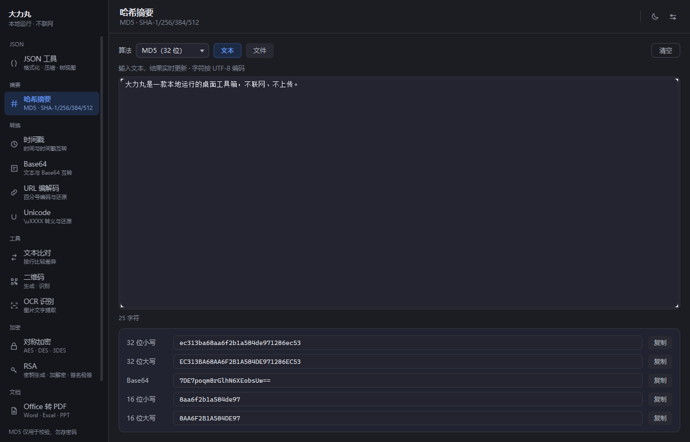
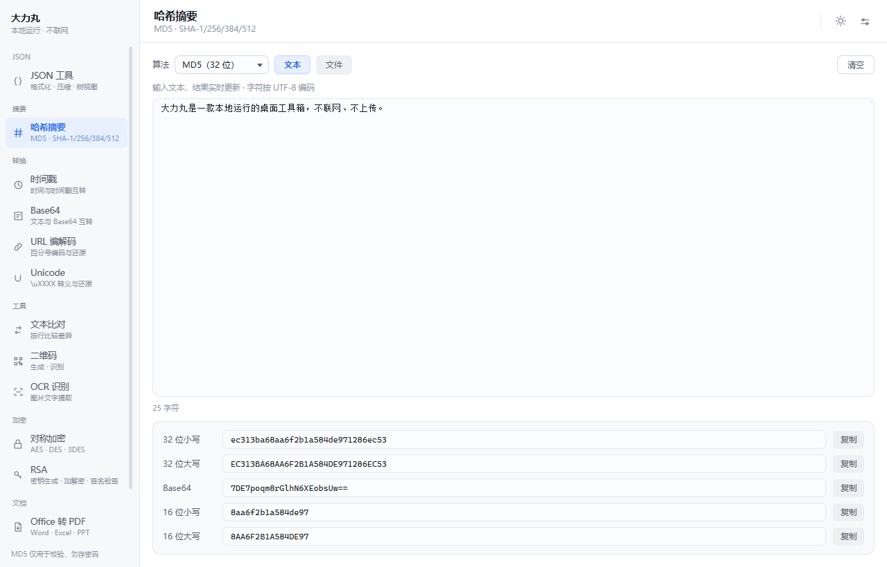

# 大力丸（DaLiWan）

一个**本地运行**的桌面工具箱：哈希摘要、JSON 处理、MyBatis 日志还原 SQL、编码转换、对称/非对称加密、二维码、文本比对、图片元数据与 OCR、Office ⇄ PDF 互转，以及 Windows 更新开关。不联网、不上传任何内容、不依赖第三方服务。

**Apache-2.0** 开源 ｜ JavaFX 25 界面 ｜ 构建与运行需 **JDK 25** ｜ 绿色版自带运行时，目标机器不用装 Java

源码仓库：<https://gitee.com/hanjiangjiaolong/daliwan-tools>

深色主题：



浅色主题：



---

## 下载与运行

**绿色版（推荐）**：解压 `release/daliwan_tool-windows-x64.zip`，双击 `大力丸.exe` 即可；整个目录拷到 U 盘也能跑。

**从源码跑**：

```bash
mvn javafx:run                  # 开发模式
java -jar target/daliwan_tool.jar
```

需要 JDK 25 与 Maven 3.9+（Office 转换引擎按 Java 25 编译）。

**打包**：`build-jpackage.bat`（加 `nopause` 参数可无人值守），产物在 `dist/daliwan_tool/` 与 `release/`。

---

## 功能一览

左侧导航 19 个页面，按使用频率分组排序；不用的页面可在设置里隐藏——**隐藏不等于删除**，它们会收进侧栏底部的「更多（N）」，随时还能选回来。

| 分组 | 页面 | 干什么 |
| --- | --- | --- |
| JSON | JSON 工具 | 格式化 · 压缩 · 树视图 · 数组转表格 · 还原 \u 转义 · 导出 xlsx |
| SQL | MyBatis SQL | 把 `Preparing` / `Parameters` 日志还原成可执行 SQL |
| 转换 | 时间戳 | 时间与时间戳互转 |
| 转换 | Base64 | 文本 / 图片 ⇄ Base64 · Data URI |
| 转换 | URL 编解码 | 百分号编码与还原 |
| 转换 | Unicode | `\uXXXX` 转义与还原 |
| 生成 | UUID · 随机串 | 批量生成标识与口令 |
| 工具 | 二维码 | 生成 · 识别 |
| 工具 | 文本比对 | 左右分屏 · 行内高亮（Myers 差分） |
| 工具 | 图片信息 | EXIF 查看 · 去除元信息 |
| 工具 | OCR 识别 | 图片文字提取（内置 RapidOCR） |
| 摘要 | 哈希摘要 | MD5 · SHA-1/256/384/512，支持大文件 |
| 加密 | 对称加密 | AES · DES · 3DES |
| 加密 | RSA | 密钥生成 · 加解密 · 签名验签 |
| 文档 | Office 转 PDF | Word / Excel / PPT 批量转，可挂右键 |
| 文档 | PDF 转 Office | 转成 Word / Excel / PPT / 文本 |
| 文档 | PDF 拆分合并 | 按页码范围拆分（`1-3,5,7-9`）或多份合并 |
| 文档 | 图片转 PDF | 多图合成一份 PDF，每图一页 |
| 系统 | Windows 更新 | 阻止 / 恢复 Windows 自动更新 |

完整的逐项清单、技术选型、已知限制与后续建议见 [docs/FEATURES.md](docs/FEATURES.md)。

---

## 资源管理器右键菜单

设置页「系统集成」里两个独立开关，都只写当前用户注册表（HKCU），**不需要管理员权限**。

| 开关 | 出现在哪些文件上 | 右键里长什么样 | 结果 |
| --- | --- | --- | --- |
| Office 转 PDF | `.doc` `.docx` `.rtf` `.odt` `.xls` `.xlsx` `.xlsm` `.xlsb` `.csv` `.ods` `.ppt` `.pptx` `.pptm` `.pps` `.ppsx` `.odp` | 「大力丸 · 转 PDF」（平铺一项） | 源文件旁生成同名 PDF |
| PDF 转 Office | `.pdf` | 「大力丸 ▸」展开出 4 项 | 转 Word / 转 Excel / 转 PPT / 提取文本 |

结果都写在源文件所在目录，同名自动加序号，绝不覆盖。程序目录搬家后启动时会按当前路径重写注册表。

> 单个动作平铺、多个动作才收成子菜单——所以 Office 上是平铺一项，PDF 上才是二级菜单。

---

## 常用设置

- **主题**：默认跟随系统深浅色，标题栏可一键切成固定深色或浅色
- **导航**：设置页可隐藏不用的页面，隐藏项收在侧栏底部「更多（N）」
- **Windows 更新**：阻止 / 恢复系统自动更新，按钮会弹 UAC；命令行等价写法 `--update-block on|off|status`
- **还原默认值**：设置页一键把所有开关拨回初始状态
- **配置位置**：`~/.daliwan/settings.properties`
- **关于**：标题栏右上角的 ⓘ，显示版本、运行时、协议与第三方组件

---

## 测试与文档

```bash
mvn test        # 358 个单元测试，core 层不引用 JavaFX，可脱离界面跑
```

| 文档 | 内容 |
| --- | --- |
| [docs/FEATURES.md](docs/FEATURES.md) | 功能逐项清单、技术选型、已知限制、后续建议 |
| [docs/DESIGN.md](docs/DESIGN.md) | 目录结构、实现要点与已知限制的细节 |

---

## 开源协议

**Apache License 2.0**，全文见 [LICENSE](LICENSE)。

- 第三方组件的许可与归属见 [NOTICE](NOTICE)；主力组件是 Stirling Office Convert（MIT）、Apache PDFBox / POI / Fesod / Jackson（Apache-2.0）、ZXing（Apache-2.0）、RichTextFX（BSD-2-Clause）、JavaFX（GPL-2.0 with Classpath Exception）
- 打包产物用 jlink 附带一份精简 OpenJDK 运行时（GPL-2.0 with Classpath Exception），目标机器无需另行安装 Java
- 仓库里没有任何商业授权组件
